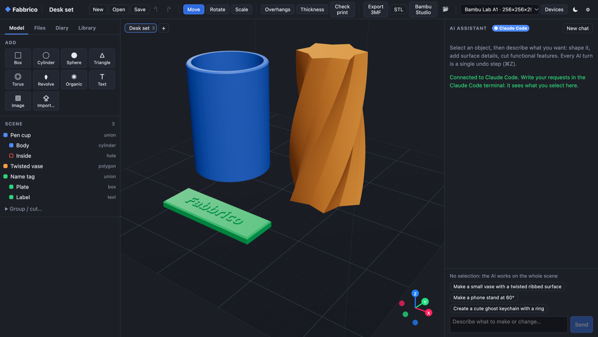

# Fabbrico

Open-source, browser-based 3D design for FDM printing. You do the simple layout by hand
(boxes, cylinders, triangles…); an AI assistant does the hard parts: shaping, surface
textures, organic forms and functional features, while keeping the model printable.



> Status: early prototype (0.1). Website: **[caccia78.github.io/fabbrico](https://caccia78.github.io/fabbrico/)**.
> See [docs/VISION.md](docs/VISION.md) for the design and roadmap.

**Requirements:** [Node.js](https://nodejs.org) 20 or newer, and a recent Chrome, Edge or Safari
(Chrome and Edge can save back to the same project file). Optional: [Claude Code](https://claude.com/claude-code)
with a Claude Pro/Max subscription, or an Anthropic API key, for the AI assistant.

## Quick start

```bash
./start.sh         # or: npm start — installs deps if needed, starts http://localhost:5173 and opens it
```

Then choose how the AI runs:

### Option A: Claude Code (uses your Claude Pro/Max subscription)

Fabbrico ships an MCP bridge (`bridge/server.ts`) that lets [Claude Code](https://claude.com/claude-code)
drive the app. No API key needed.

1. Keep Fabbrico open in the browser (`./start.sh`).
2. In another terminal, from the project folder, run `claude`. The first time, approve the
   project MCP server **fabbrico** (it is declared in `.mcp.json`). `/mcp` shows its status.
3. When the chat panel in Fabbrico shows **● Claude Code**, select an object in Fabbrico and write
   your request in the Claude Code terminal, e.g. *"round the selected object's edges by 2 mm
   and give it a knurled texture on the sides"*.

Claude reads the scene and your selection (`get_scene`), edits it, renders the result to check
it and runs the printability check. Requests close together form one undo step (⌘Z) in Fabbrico.

The bridge listens only on `127.0.0.1:5180` and accepts connections only from pages served by
`localhost`. Settings: `FABBRICO_BRIDGE_PORT`, `FABBRICO_URL`, `FABBRICO_ALLOWED_ORIGIN` (env vars in
`.mcp.json`). To test the bridge without Claude: `npx tsx bridge/smoke-test.ts` with Fabbrico
open (it adds a test object to the scene).

### Option B: in-app chat (Anthropic API key)

Open ⚙ Settings and paste an Anthropic API key (billed per use on the Anthropic Console).
The key is stored only in your browser (localStorage) and sent directly to
`api.anthropic.com`. Fabbrico has no server.

## How it works

- **Scene = JSON tree** (`src/model/schema.ts`): primitives, extruded polygons, revolved
  profiles, text (Droid fonts, Apache 2.0, in `src/geometry/fonts`), images (relief, lithophane, logo),
  imported meshes (STL, OBJ, GLB/glTF, 3MF; stored in IndexedDB and embedded in project files),
  signed-distance (SDF) shapes and groups, each with a stack of modifiers.
  Everything, including what the AI does, is an edit to this tree, so it stays parametric and
  every AI turn is a single undo step.
- **Geometry kernel** (`src/geometry/kernel.ts`): [Manifold](https://github.com/elalish/manifold)
  (WASM) guarantees watertight output for every boolean. It runs in a Web Worker
  (`worker.ts`, driven from `client.ts`), so heavy builds never freeze the UI: the previous
  result stays on screen while a new one computes, and a slow build can be cancelled. Modifiers: `round` (true fillet), `chamfer` (45° bevel on top / bottom / all edges), `teardrop` (support-free horizontal holes),
  `smooth`, `displace` (noise, waves, ribs, knurl, bumps, cells, custom), `twist`, `taper`,
  `bend`, `warp` (free-form math.js deformation).
- **AI** (`src/ai/`): one set of tools (`toolSpecs.ts`, implemented in `tools.ts`) used both by
  the in-app chat (`agent.ts`) and by Claude Code through the bridge (`bridge.ts` ↔
  `bridge/server.ts`). Claude edits the scene through tools (`add_object`, `update_object`,
  `group_objects`, `duplicate_objects`, `get_outline`, `add_plate`, `render_view`,
  `check_printability`…). `get_outline` returns the exact world-space cross-section of any object
  (a tracing, a mesh, a group), optionally offset, so walls and pockets can follow it. It sees your current view, renders
  its own result to check it, and runs the printability check before answering.
- **Printability** (`src/geometry/analysis.ts`): bed fit, below-bed and floating parts,
  separate bodies, overhang percentage, wall thickness (`thickness.ts`: a ray from each surface
  point into the material, on a refined mesh, with a BVH) and heat maps for overhangs and
  thickness in the viewport. "Orient for print" (`orient.ts`) tries the convex hull's faces as
  the bottom and picks the one with the least estimated support volume.
- **Projects** (`src/model/project.ts`): `.fabbrico` files are readable JSON
  (`{ format, version, name, plates: [{ name, scene }] }`), validated on open. Projects saved under the app's former name (`.forma`) still open. Each plate (tabs over
  the viewport) has its own objects and undo history; export covers the active plate. In Chrome and Edge ⌘S writes back to
  the same file; other browsers download a copy. The current scene is also kept in the browser
  between reloads.
- **Export**: 3MF (recommended) or binary STL.

## Tablet and phone

**Devices** in the top bar shows a QR code. The same code opens a different page on each device:

| Device | What it can do |
| --- | --- |
| 📲 Tablet (iPad + Apple Pencil) | trace objects, sketch parts with dimensions, photos, measurement notes, AR preview |
| 📱 Phone (iPhone or any phone) | photos, measurement notes, AR preview (no tracing: the screen is too small) |

The page picks the kind from the screen size; the phone page has a link to switch.

**Sketch** (tablet, Trace / Sketch switch at the top): draw the part on one sheet, with all the views you need
and the dimensions written in mm. Hold the pencil still at the end of a stroke to turn it into a clean line
(snapped to horizontal, vertical or 45°), circle or rectangle. **Send sketch** puts it in the Files tab; the
sketch stays on the tablet, and sending it again updates the same one. Then ask the AI to model it: it reads
the written dimensions and asks when one is missing. **Clear** starts a new sketch.

## Tablet tracing (iPad + Apple Pencil)

Trace real objects on a tablet and bring the outlines into Fabbrico.

1. Start Fabbrico with `./start.sh` (the dev server also listens on your local network).
2. Click **Tablet** in the top bar and scan the QR code with the iPad (same Wi-Fi). In Safari,
   *Add to Home Screen* keeps it one tap away.
3. Put the object on the screen, pick the side facing up (top, front, right…), trace around it
   with the pencil and tap **Send to Fabbrico**. The page knows the iPad's screen scale (📏 to check it
   against a ruler).
4. In Fabbrico, **Extrude** a tracing, or select tracings of the same object from different sides and
   **Combine** them: their extrusions are intersected into an approximate 3D shape to refine.

The pairing code in the QR code is the only way in: only Fabbrico on this computer can receive, and
**New pairing code** cuts off previously paired tablets. Code: `server/padRelay.ts` (relay),
`src/pad/` (tablet page), `src/tablet/` (outlines, views).

## Controls

| Action | How |
| --- | --- |
| Select | click an object or a row in the scene list |
| Move / rotate / scale | gizmo, `T` / `R` / `S` |
| Resize in mm | inspector **size mm** (🔗 keeps proportions): simple shapes change their own dimensions, so fillets, chamfers and holes keep their size; groups and meshes are scaled |
| Undo / redo | `⌘Z` / `⇧⌘Z` |
| Cut a hole | mark an object as *hole*, then group it with the target |
| Import a mesh | **Import…** in Add, or drop an STL / OBJ / GLB / 3MF file on the window |
| Texture one face | displace → faces *picked* → **Pick face**, then click the face |
| Duplicate | `⌘D` |
| Copy / paste (also onto another plate) | `⌘C` / `⌘V` |
| Delete | `Delete` / `Backspace` |
| Save / save as / open project | `⌘S` / `⇧⌘S` / `⌘O`, or drop a `.fabbrico` file on the window |
| Reference photos | **Files** tab → Photos **+ Add**, drop pictures on the window, or 📷 on a connected tablet or phone. Click one to add a caption and link it to an object; the AI can look at them |
| Printer / bed size | Printer menu in the top bar (Bambu Lab, Prusa, Creality presets) or **Custom** to type the sizes in ⚙ Settings. The viewport shows the build volume |
| Measurement notes | **Files** tab → Notes **+ Add**, or 📝 on a tablet or phone. The AI treats them as reliable sizes |
| AR preview | 🧊 on a tablet or phone (iPhone / iPad, Safari): the current plate at real size on your table |
| See the project's files | **Files** tab: photos, images of image objects, imported meshes, tracings |
| Send to the slicer | **Bambu Studio** (or OrcaSlicer / PrusaSlicer, whichever is installed): saves the current plate as 3MF in `~/Documents/Fabbrico` and opens it there |
| Open the export folder | 📂 in the top bar |

The slicer and folder buttons only appear when Fabbrico runs from its own dev server (`npm start`),
which does these steps on this computer (`server/localActions.ts`). Set `FABBRICO_EXPORT_DIR` to
use another folder.

## Privacy and security

- Projects, photos and settings stay on your computer (files you save and browser storage).
- AI requests go to Anthropic: through Claude Code, or directly from the browser with your API key.
- The dev server also listens on your local network so a tablet or phone can connect. Only
  devices that scanned the current pairing code can send to it, and only this computer can
  use the local actions (slicer, export folder, experience library).

## Contributing

Issues and ideas are very welcome: see [CONTRIBUTING.md](CONTRIBUTING.md).

## License

MIT, see [LICENSE](LICENSE). Third-party work: [THIRD_PARTY_NOTICES.md](THIRD_PARTY_NOTICES.md).
